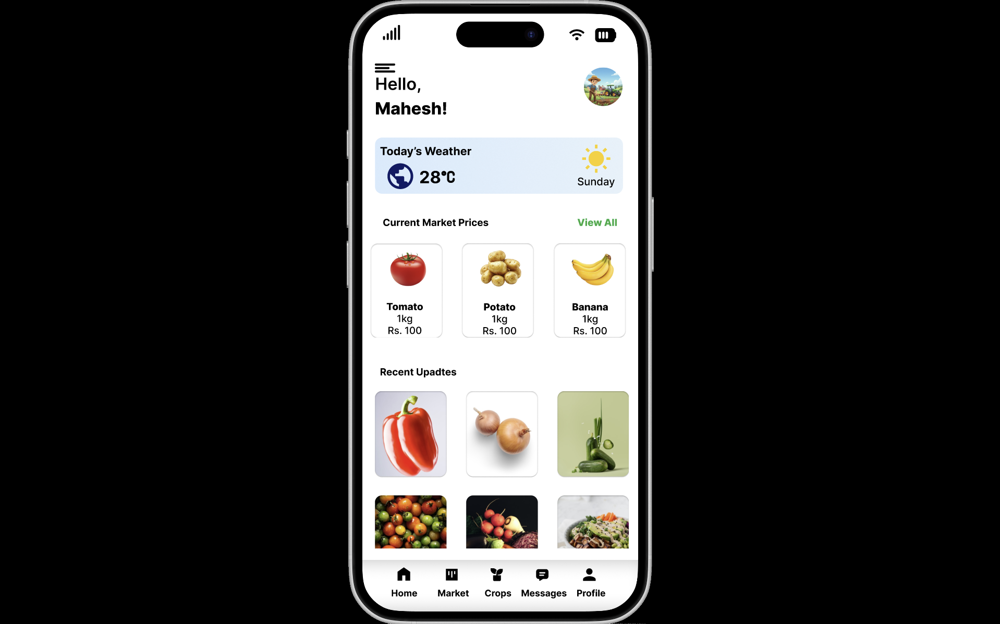

# 🌱 AgriLink

### Smart Farming & Agriculture Management App

**Connect. Manage. Trade.**

 

A Smart Agricultural Management & Marketplace
designed to empower farmers through technology.

 

[View Figma Prototype](https://www.figma.com/proto/QFFk5Ui2nGknVJaZUJeHs5/Untitled?node-id=0-1&t=jeDZmpOoQ0bcQrVD-1)

---

## 📌 Project Overview

AgriLink is a smart agricultural management and
marketplace application designed to help farmers
manage their farming activities and connect directly
with buyers and agricultural experts.

The platform provides a centralized solution for
crop management, real-time market price monitoring,
weather alerts, expert consultation, and direct
agricultural trading.

The main objective is to simplify farming operations,
improve market accessibility, and help farmers
achieve better financial outcomes.

---

## 🎯 Project Goals

- Connect farmers directly with buyers.
- Provide transparent agricultural market prices.
- Simplify crop lifecycle management.
- Deliver weather and pest alerts.
- Provide access to agricultural experts.
- Improve farming productivity and efficiency.

---

## ✨ Key Features

| Feature | Description |
|---|---|
| 📊 Market Prices | Monitor agricultural commodity prices. |
| 🛒 Direct Marketplace | Connect farmers with potential buyers. |
| 🌱 Crop Management | Track crop growth and harvest schedules. |
| 🌦️ Weather Alerts | Receive weather and farming alerts. |
| 👨‍🌾 Expert Consultation | Connect with agricultural experts. |
| 🔔 Notifications | Receive important farming updates. |
| 📦 Order History | Manage listings and order information. |
| 👤 User Profile | Manage personal account information. |

---

## 🎨 UI/UX Design Process

The project followed a user-centered design approach.

1. Research & Discovery
2. User Persona Development
3. Problem Identification
4. Competitor Analysis
5. User Stories
6. Information Architecture
7. Low-Fidelity Wireframing
8. High-Fidelity UI Design
9. Interactive Prototyping

---

## 📱 Application Screens

### 01. Authentication & Onboarding

- Splash Screen
- Welcome Screens
- Login
- Create Account

### 02. Home Dashboard

- Weather Information
- Current Market Prices
- Featured Products
- Recent Updates

### 03. Marketplace

- Product Listings
- Product Details
- Add New Product
- My Listings

### 04. Market Prices

- Vegetable Prices
- Fruit Prices
- Commodity Price Updates

### 05. Crop Management

- Active Crops
- Completed Crops
- Add New Crop
- Sowing & Harvest Dates

### 06. Weather & Farming Alerts

- Weather Forecast
- Rainfall Information
- Pest Alerts
- Farming Notifications

### 07. Expert Consultation

- Agricultural Experts
- Expert Profiles
- Chat
- Appointment Booking

### 08. Profile & Notifications

- Personal Information
- Order History
- Reviews
- Notifications
- Account Settings

---

## 🖼️ Design Preview

<!-- Add your exported Figma screenshots here -->

### Home Dashboard

### Market Prices

### Crop Management

### Weather & Alerts

### Product Listing

### Expert Consultation

---

## 🎨 Design System

### Color Palette

| Color | Hex Code | Usage |
|---|---|---|
| Primary Green | `#4E7C41` | Primary brand color |
| Success Green | `#2E7D32` | Success indicators |
| Primary Text | `#212121` | Main text |
| Warning Orange | `#F57C00` | Warning indicators |
| Light Green | `#E8EFE8` | Background elements |
| Red | `#D32F2F` | Critical alerts |

### Typography

**Font Family:** Poppins

---

## 🛠️ Tools & Technologies

- Figma
- UI/UX Design
- User Research
- Wireframing
- Prototyping
- Information Architecture
- User Persona Development

---

## 🔗 Interactive Figma Prototype

Explore the complete AgriLink mobile application
prototype through the link below.

### 🌱 Experience AgriLink

[**OPEN FIGMA PROTOTYPE →**](https://www.figma.com/proto/QFFk5Ui2nGknVJaZUJeHs5/Untitled?node-id=0-1&t=jeDZmpOoQ0bcQrVD-1)

---

## 💡 Key Learnings

- Understanding user-centered design principles.
- Creating user personas and user stories.
- Designing intuitive mobile interfaces.
- Developing information architecture.
- Creating low and high-fidelity wireframes.
- Building interactive prototypes using Figma.
- Improving usability through visual hierarchy.

---

## 👥 Project Team

**Group No: 07**

Department of ICT  
Faculty of Technological Studies  
University of Vavuniya

| Registration No. | Team Member |
|---|---|
| 2023/ICTS/74 | Rajapaksha S.R.H.D. |
| 2023/ICTS/75 | Wedagedara O.D. |
| 2023/ICTS/76 | Prasanna H.P.G.M.D. |
| 2023/ICTS/77 | Dissanayaka D.M.T.S. |
| 2023/ICTS/78 | Kumara P.P.M.N. |
| 2023/ICTS/79 | Jayasundara J.H.S. |
| 2023/ICTS/80 | Ariyarathne W.M.N.N. |
| 2023/ICTS/82 | Fahima T. |
| 2023/ICTS/83 | Edirisingha S.L.K.N. |
| 2023/ICTS/84 | Ranaweera M.K.H.A.N. |

---

## 📌 Project Information

- **Project Name:** AgriLink
- **Project Type:** Academic Group Project
- **Category:** UI/UX Design
- **Design Tool:** Figma
- **Platform:** Mobile Application
- **Group:** 07
- **University:** University of Vavuniya

---

### 🌱 AgriLink

**Connecting Farmers. Empowering Agriculture.**

Designed with ❤️ using Figma.

